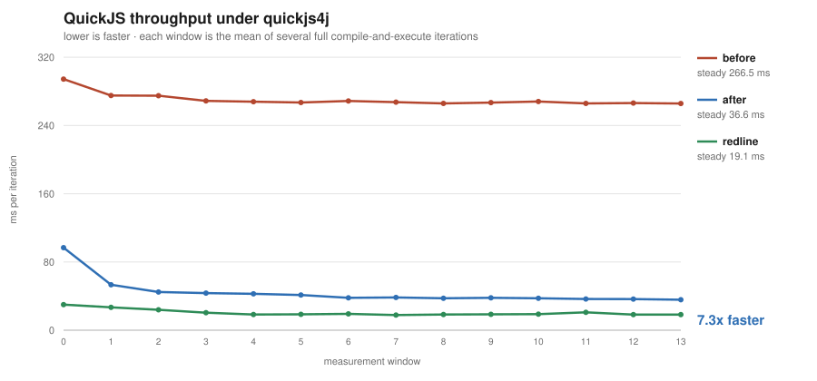

# QuickJS throughput: splitting oversized functions for the JIT

Same quickjs4j source and JVM throughout. `before` and `after` differ only in which build of the endive compiler precompiled the Javy plugin bytecode inside the quickjs4j jar; `redline`, where present, swaps the bytecode backend for natively compiled code and is a reference point rather than part of the before/after comparison.

- **before** &mdash; endive at `bce75ae6 chore(deps): bump de.mannodermaus.android-junit5 in /android-tests (#244)`
- **after** &nbsp;&mdash; endive at this branch (test(benchmarks): add Redline as a third point of comparison)
- **redline** &mdash; endive `999-SNAPSHOT`, native via Cranelift

Measured on `openjdk version "27.0.1.0.3" 2026-10-24`.

| | first window | steady state | best | functions split | interpreted |
|---|---|---|---|---|---|
| before | 297.5 ms | **274.0 ms** | 270.2 ms | 0 | 0 |
| after | 104.1 ms | **36.6 ms** | 36.2 ms | 14 | 0 |
| redline (native) | 29.3 ms | **17.5 ms** | 17.2 ms | n/a | n/a |
| | | **7.5x faster** | 7.5x | | |

The Redline backend, which compiles to native code via Cranelift instead of to JVM bytecode, reaches **17.5 ms** steady -- 2.1x faster than the split bytecode path, which therefore closes 93% of the distance from the unsplit baseline to native.

Redline was built from this same checkout, so all three configurations share one endive, and the runner it selected was **RedlineInstanceBuilderProvider (native, PanamaMachineFactoryProvider)** -- the intended one on this JDK. This branch does not touch the Redline path, so it is a reference point for how much of the gap to native the bytecode path closes, not a rival measurement.

## Per-window timings

| window | before (ms) | after (ms) | redline (ms) |
|---|---|---|---|
| 0 | 297.5 | 104.1 | 29.3 |
| 1 | 280.6 | 49.9 | 24.5 |
| 2 | 277.9 | 46.3 | 21.8 |
| 3 | 274.3 | 44.2 | 21.9 |
| 4 | 272.5 | 42.8 | 18.2 |
| 5 | 272.8 | 40.7 | 18.4 |
| 6 | 271.8 | 37.7 | 18.9 |
| 7 | 272.3 | 38.0 | 17.8 |
| 8 | 272.5 | 36.3 | 17.8 |
| 9 | 271.5 | 36.7 | 17.3 |
| 10 | 275.7 | 37.1 | 17.4 |
| 11 | 278.2 | 36.2 | 18.1 |
| 12 | 272.0 | 36.9 | 17.3 |
| 13 | 270.2 | 36.4 | 17.2 |

The shape matters more than the totals. `before` is flat: a method past HotSpot's `HugeMethodLimit` is never JIT-compiled, so it is as slow in the last window as the first. `after` starts comparable and improves as HotSpot compiles the chunks.

